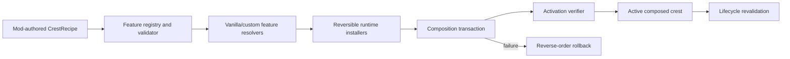

# Crest Composition Framework Foundation

## Status

The code under `Framework/Experimental` is the first reusable boundary extracted from Void Crest
Compatibility. It is intentionally not wired into the released 1.0.0 runtime yet.

The foundation currently provides:

- extensible feature descriptors and a registry;
- standard moveset/component slots;
- immutable composition recipes;
- dependency, conflict, and slot-kind validation;
- structured diagnostics;
- a rollback transaction that includes a partially applied failing step;
- an initial metadata catalog for understood vanilla features.

It does not yet clone Unity objects, patch game methods, activate FSM routes, or replace the current
Void Crest switching path.

## Architectural boundary



The registry is metadata. A runtime adapter is responsible for turning a registered feature into
reversible Unity and Harmony operations.

## Feature identity

Feature IDs are stable, ordinal strings. Examples:

```text
vanilla.hunter.attack.normal
vanilla.hunter.progression.evolution
vanilla.hunter.passive.focus
vanilla.reaper.state.harvest
vanilla.reaper.bind.activate-harvest
vanilla.warrior.passive.rage
vanilla.spell.audio.profile
```

A descriptor declares:

- provider crest;
- broad feature kind;
- reference, clone, proxy, or custom transfer mode;
- whether functional identity or runtime state is required;
- whether lifecycle revalidation is required;
- dependencies and conflicts;
- human-readable reverse-engineering evidence.

Registration is not proof that the runtime feature works. It is a discoverable contract for an
adapter to implement.

## Recipes

Exclusive behavior uses named slots. Additive behavior such as passives and runtime services is
selected separately.

```csharp
CrestFeatureRegistry registry = VanillaCrestFeatureCatalog.CreateRegistry();

string hunterNormal = VanillaCrestFeatureCatalog.FeatureId("Hunter", "attack", "normal");
string hunterProgression = VanillaCrestFeatureCatalog.FeatureId("Hunter", "progression", "evolution");
string hunterFocus = VanillaCrestFeatureCatalog.FeatureId("Hunter", "passive", "focus");
string reaperState = VanillaCrestFeatureCatalog.FeatureId("Reaper", "state", "harvest");
string reaperBind = VanillaCrestFeatureCatalog.FeatureId("Reaper", "bind", "activate-harvest");

CrestRecipe recipe = CrestRecipeBuilder.Create("my-hybrid", "MyCustomCrest")
    .Use(StandardCrestSlots.NormalAttack, hunterNormal)
    .Add(hunterProgression)
    .Add(hunterFocus)
    .Add(reaperState)
    .Use(StandardCrestSlots.Bind, reaperBind)
    .Build();

CrestRecipeValidationResult validation = CrestRecipeValidator.Validate(recipe, registry);
```

This example deliberately separates Hunter's attack, progression, and Focus from Reaper's state
and Bind activation. A whole-crest helper can later populate all standard slots without changing
the underlying model.

## Transaction contract

Runtime installation must be expressed as reversible steps:

```csharp
new CrestCompositionTransaction("activate-my-hybrid", diagnostics)
    .Add(new CrestTransactionStep("clone attacks", CloneAttacks, RestorePreviousAttacks))
    .Add(new CrestTransactionStep("install identity routes", InstallRoutes, RemoveRoutes))
    .Add(new CrestTransactionStep("activate config", ActivateConfig, RestorePreviousConfig))
    .Add(new CrestTransactionStep("verify", VerifyActiveState, RestorePreviousConfig))
    .Execute();
```

The transaction records a step before invoking its apply action. If that action mutates half of a
Unity hierarchy and then throws, its rollback still runs. Earlier steps roll back afterward in
reverse order. Rollback failures are preserved alongside the original failure.

Every Unity adapter must capture its rollback state before mutation. The transaction cannot
recover data that an adapter destroyed without preserving.

## Planned runtime interfaces

The next implementation layer should introduce:

- `ICrestFeatureResolver` - finds versioned vanilla/custom source objects;
- `ICrestFeatureInstaller` - stages reversible runtime mutations;
- `ICrestIdentityRouter` - supplies provider identity only to authorized call sites;
- `ICrestActivationVerifier` - proves the expected config, objects, FSMs, and state are live;
- `ICrestLifecycleService` - revalidates or reapplies after reset/update/scene events;
- `CrestObjectProvenance` - records source object, clone owner, path, and active recipe;
- `CrestRuntimeSnapshot` - retains the previous working composition until commit.

Harmony patching, reflection, Unity object cloning, and PlayMaker traversal should remain behind
those interfaces. Mod authors should work with feature IDs and recipes.

## Migration from Void Crest Compatibility

1. Move crest/config alias resolution into a resolver with explicit provider IDs.
2. Represent the existing eight Base Crest choices as generated recipes.
3. Convert each attack field replacement into a reversible clone/remap step.
4. Convert each Harmony/PlayMaker proxy into an identity-route registration owned by a feature.
5. Convert Hunter, Wanderer, Reaper, Beast, and Shaman logic into separate installers.
6. Replace `activeBaseCrest` switching with a retained `CrestRuntimeSnapshot` and transaction.
7. Verify the active `ConfigGroup` by object identity after every commit and lifecycle event.
8. Keep the original Void Crest behavior as ordinary host-owned features rather than special cases
   embedded throughout the framework.

## Verification

Run the framework-only tests without the game:

```powershell
./tests/CrestFrameworkFoundation.Tests.ps1
```

Regenerate the managed-IL inventory after a game update:

```powershell
./tools/Inspect-CrestSystem.ps1 `
  -AssemblyCSharp "<game>/Hollow Knight Silksong_Data/Managed/Assembly-CSharp.dll" `
  -MonoCecil "<profile>/BepInEx/core/Mono.Cecil.dll" `
  -OutputPath ./docs/evidence/VANILLA_CREST_INVENTORY.md
```

Gameplay verification is still required for runtime adapters.

Use [`GAMEPLAY_VALIDATION_MATRIX.md`](GAMEPLAY_VALIDATION_MATRIX.md) for the required lifecycle and per-crest coverage, then summarize the resulting BepInEx log with `tools/Summarize-CrestRuntimeLog.ps1`.
